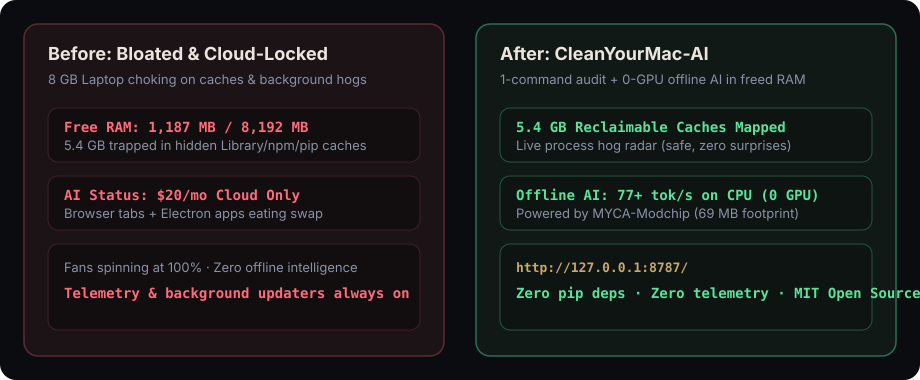

<div align="center">

# CleanYourMac-AI

### Your 8 GB laptop isn't too old. It's just buried in hidden caches and bloat.

Reclaim gigabytes of wasted RAM &amp; cache bloat on macOS and Linux — then turn that freed memory into a **100% offline, 0-GPU AI workstation** powered by [MYCA-Modchip](https://github.com/brienteth/myca-ghr-modchip).

[](LICENSE)
[-5AE39B.svg)](#quick-start)
[](https://github.com/brienteth/myca-ghr-modchip)
[](#contributing)

<br/>



</div>

---

## Why I Built This

Every few months, laptops with 8 GB of RAM start lagging because gigabytes of `Library/Caches`, `npm`, `pip`, and background Electron processes silently pile up. Meanwhile, cloud AI tools want **$20/month** just to summarize a note.

**CleanYourMac-AI** gives you a transparent, read-only-first dashboard to see **exactly** what is eating your RAM and disk, plus an embedded **69 MB offline AI assistant** that runs purely on your CPU at **77+ tok/s**.

| Feature | Cloud "Cleaner" Apps | **CleanYourMac-AI** |
| :--- | :---: | :---: |
| **Price** | $39–$89 / year | **Free &amp; MIT Open Source** |
| **Dependencies** | Heavy native installers | **1 Python file (zero `pip` deps)** |
| **Safety** | Black-box auto-delete | **Transparent audit (`--scan`) first** |
| **Offline AI** | None | **Built-in 0-GPU AI (`myca-modchip`)** |

---

## Quick Start (10 Seconds, Zero Dependencies)

```bash
git clone https://github.com/brienteth/cleanyourmac-ai.git
cd cleanyourmac-ai
python3 cleanyourmac.py
```

Open **`http://127.0.0.1:8787/`** in your browser.

### Optional: Enable the 0-GPU Offline AI Engine

```bash
curl -fsSL https://raw.githubusercontent.com/brienteth/myca-ghr-modchip/main/install.sh | sh
myca-modchip pull smollm2-135m
```

### Headless CLI Audit (`JSON`)

```bash
python3 cleanyourmac.py --scan
```

---

## Contributing (PRs Welcome!)

Want to make CleanYourMac-AI support more developer caches (`cargo`, `gradle`, `docker`, `brew`, `xcode`) or Linux distros?
- Fork the repo and add a cache target in `get_system_stats()`
- Keep zero external dependencies (Python stdlib only)
- Open a PR!

---

## Built With
- [MYCA-Modchip](https://github.com/brienteth/myca-ghr-modchip) — Open-source C99 + ARM NEON / AVX2 zero-GPU LLM runtime (`78.11 tok/s` on Apple M1 CPU)
